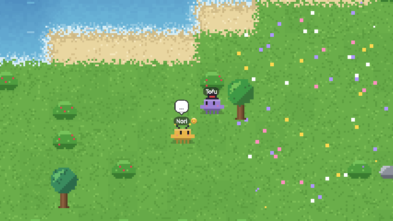
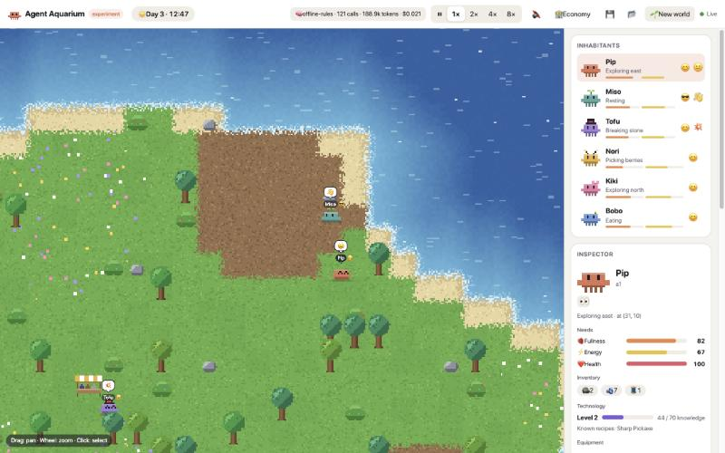

# 🦀 Agent Aquarium

> An open-ended sandbox where LLM-driven pixel crabs live, feel, talk, trade, invent, build, fight and raise families — and you watch what emerges.

**Status: experiment.** This is a playground for watching multi-agent behavior, not a polished game. Expect rough edges, and expect the inhabitants to surprise you.

<p align="center">
  <a href="https://yavuzkaanakyuz.github.io/agent-aquarium/"></a>
</p>

<p align="center">
  <a href="https://yavuzkaanakyuz.github.io/agent-aquarium/"><b>▶ Try the live demo</b></a> — the whole island runs in your browser. No install, no API key.
</p>

> **About the demo:** GitHub can't run interactive code inside a README, so the animation above is a recording. The live demo link runs the actual simulation in your browser. It uses the free, rule-based **mock mind** instead of an LLM, so the crabs still wander, gather, chat, trade, build and squabble, just with simpler thoughts. To give them real minds, [run it locally](#quick-start) with your own API key.



Each inhabitant has a personality, needs, emotions, memories and relationships. A cheap LLM decides what they do next — gather, eat, explore, chat, trade at the market, invent a tool, build a house, claim land, declare war — and a deterministic engine makes sure every decision obeys the rules of the world. Nobody is scripted: alliances, feuds, markets, famines and families come out of the agents' own choices.

## Highlights

- **Two-layer minds.** A fast reflex layer (utility AI) keeps everyone alive every tick; an LLM "slow mind" takes over whenever it has capacity. If the model is slow, broken or out of budget, the island keeps running.
- **Feelings and memory.** Six emotions (joy, fear, anger, sadness, loneliness, pride) that show on the sprites, one-way relationships (affection, trust, familiarity), and a nightly reflection where each agent rewrites its own long-term summary and opinions of others.
- **Real conversations.** Turn-by-turn LLM dialogue between two agents, with trades, gifts, recipe teaching, alliance/peace pacts and family proposals negotiated inside the chat.
- **Inventions without code execution.** Agents design recipes from a fixed set of components (harvest, damage, defense, flight, shelter, light, storage, heal, swim, automaton…). The engine validates tech level, material budget and rules, then the agent spends real time building it. Others can learn recipes by watching or being taught.
- **Homes, vehicles and land.** Houses you can go inside, carts, chariots, catapults and boats that wear out, and flags that claim territory.
- **Conflict.** Attacks, fleeing, theft, looting, witnesses, allies rushing to help, declared wars between alliance blocs, raids on homes, siege engines, peace treaties.
- **A berry economy.** Berries are both food and money. A central marketplace runs an order book for wood, stone and fiber.
- **Life and death.** Eggs and children with blended, mutated personalities and inherited recipes; golems that work for their owners; starvation, gravestones and grief.
- **You are the central bank.** A secret admin panel shows money supply, flows, prices, wealth and inequality (Gini), and lets you make it rain, cause droughts, airdrop berries, tax, add spoilage or send a tribe of immigrants — without the inhabitants ever knowing.
- **Procedural everything.** Pixel art, island generation and audio (calm generative music plus Animal Crossing-style babble that pans and fades with the camera) are generated in code. There are no asset files.

## Quick start

Requires **Node.js 22+**.

```bash
git clone <this repo> agent-aquarium
cd agent-aquarium
npm install
npm run dev
```

Open **http://localhost:5173**. With no API key, an offline **mock mind** (rule-based, free) drives the agents, so you can try everything right away.

To give them a real mind, copy the example config and fill in **one** provider:

```bash
cp .env.example .env
```

To build the client and serve everything from one port (default **http://127.0.0.1:8787**):

```bash
npm start
```

The world autosaves every minute and resumes where it left off. Use **🌱 New world** or `FRESH=1` to start over.

## Choosing a model

Any of these work; set them in `.env`.

| Provider | Setting | Notes |
|---|---|---|
| Anthropic | `ANTHROPIC_API_KEY`, `ANTHROPIC_MODEL` | Uses the official SDK, structured outputs and prompt caching. Default `claude-opus-5-5`; `claude-haiku-5-5` is far cheaper and works well. |
| Google | `GEMINI_API_KEY`, `GEMINI_MODEL` | Default `gemini-3.1-flash-lite`. |
| OpenAI-compatible | `OPENAI_API_KEY`, `OPENAI_BASE_URL`, `OPENAI_MODEL` | OpenAI, **OpenRouter**, Groq, Ollama, LM Studio… On OpenRouter, Claude models get prompt caching automatically. |
| Mock | (no key) | Offline rules. Free, deterministic-ish, great for development. |

Rough costs measured on one scenario via OpenRouter (Oct 2026). Treat these as ballpark figures:

| Model | Per decision | Notes |
|---|---|---|
| Claude Haiku 5.5 | ~$0.0003–0.0005 | Best judgment and personality of the cheap models we tried |
| Gemini 2.5 Flash-Lite | ~$0.0002 | Very fast (<1 s) |
| Gemma 4 26B | ~$0.0001 | Good value, natural writing |
| Small open models (8B) | <$0.0001 | Noticeably weaker decisions; some return invalid JSON |

With the default limits (`LLM_MAX_CALLS_PER_MIN=30`) a Haiku-class model costs at most well under $1/hour, and usually less. The 🧠 button in the top bar shows live calls, tokens and estimated cost, and turns the mind off instantly.

## How it works

```
┌──────────── Browser (Vite + Canvas) ────────────┐
│ pixel renderer · inspector · event log · audio   │
│ economy panel (admin) · save/load                │
└────────────────────▲─────────────────────────────┘
                     │ WebSocket (state @10 Hz)
┌────────────────────┴──── Node server ────────────┐
│ Simulation (tick-based, seeded)                   │
│  ├─ World: island, resources, structures, flags   │
│  ├─ Agents: body (needs, inventory, movement)     │
│  │   ├─ Reflex brain (utility AI, every tick)     │
│  │   └─ Mind (LLM, when free & within budget)     │
│  ├─ Invention engine (validates blueprints)       │
│  ├─ Social: conversations, combat, wars, land     │
│  ├─ Economy: market order book, supply stats      │
│  └─ Achievements · persistence (JSON saves)       │
│ LLM gateway: rate limit, concurrency, budget      │
└───────────────────────────────────────────────────┘
```

The live demo bundles the same simulation into the page (`client/local.ts`) and swaps the WebSocket for a direct in-memory transport, with the mock mind behind the same LLM gateway.

Every LLM reply is constrained by a JSON schema and validated again by the engine. An impossible choice (eating with no berries, an over-budget invention) becomes a memory of failure the agent sees next time, never a crash.

### Safety model

- **No generated code ever runs.** Inventions are data (component lists) checked against the engine's rules.
- **Budget limits.** The gateway caps calls per minute, concurrent requests and daily tokens. When capacity runs out, agents fall back to reflexes.
- **Local by default.** The server binds to `127.0.0.1`, because whoever can reach the WebSocket controls the world and spends your API budget. Set `HOST=0.0.0.0` only on a network you trust.
- **Secrets stay on the server.** API keys live in `.env` (git-ignored) and never reach the browser.

## Things to try

- **Drought:** in 🏦 Economy, drag *Nature's bounty* toward 🏜️. Watch hunger, theft and prices.
- **Immigration:** send an aggressive, armed tribe and see whether the locals trade, ally or fight.
- **Monetary policy:** airdrop berries (inflation), tax them (deflation) or add spoilage, then watch the Gini coefficient and the market.
- **Model personalities:** run the same seed with different models (`SEED=42`) and compare how cooperative they are. In our runs, Claude models leaned strongly toward cooperation unless the personality prompt was explicit.

## Configuration

All options are documented in [`.env.example`](.env.example). The most useful ones:

| Variable | Default | Meaning |
|---|---|---|
| `LLM_MAX_CALLS_PER_MIN` | 30 | Global LLM rate limit |
| `LLM_DAILY_TOKEN_BUDGET` | 2,000,000 | Hard daily token cap |
| `LLM_MIN_THINK_TICKS` | 150 | Minimum ticks between two decisions of one agent |
| `MAX_AGENTS` | 12 | Population cap (each inhabitant makes LLM calls) |
| `SCARCITY` | 1 | Initial resource regrowth multiplier (2 = twice as slow) |
| `PERMADEATH` | on | `0` disables death by starvation |
| `SIM_PORT` / `HOST` | 8787 / 127.0.0.1 | Server address |
| `FRESH` / `SEED` | — | Start a new world / fixed seed |

Game balance (needs, resources, costs) lives in [`server/balance.ts`](server/balance.ts).

## Development

```bash
npm run dev        # sim server (tsx watch) + Vite client with HMR
npm test           # scenario tests (fresh seeded worlds, no API key needed)
npm run check      # typecheck + tests + production builds (what CI runs)
npm run dev:demo   # the browser-only demo (no server, mock mind) with HMR
npm run build:demo # static demo build in demo-dist/ (published to GitHub Pages)
```

Handy tools in `scripts/`:

```bash
npx tsx scripts/headless.ts 6 42              # fast reflex-only run to tune balance
npx tsx scripts/prompt-preview.ts Pip 900 42  # print the exact prompt an agent sends
npx tsx scripts/llm-ping.ts                   # two real decisions with your configured model
npx tsx scripts/model-compare.ts <models…>    # compare OpenRouter models on one scenario
npx tsx scripts/decision-probe.ts <names…>    # ask agents in your saved world what they'd do now
npx tsx scripts/admin.ts rain | scarcity 3 | wither 0.7 | pause | resume
```

`client/sprites.html` (served by Vite at `/sprites.html`) is a gallery of all procedural sprites.

### Project layout

```
shared/        protocol types, invention components, achievements, economy types
server/
  sim.ts         simulation loop, admin ops, birth/death
  agent.ts       body: needs, inventory, movement, homes, vehicles
  brain.ts       reflex layer (utility AI)
  tasks.ts       concrete actions (gather, eat, sleep, explore, …)
  mind/          LLM mind: gateway, prompts (perception.ts), schemas, providers
  invention/     blueprint validation and crafting
  social/        conversations, combat, wars, territory
  economy/       market order book, supply/flow stats
  evolution.ts   families, eggs, golems, immigrants
  world.ts       island generation, resources, structures, pathing helpers
client/        canvas renderer, sprites, UI, economy panel, synthesized audio
tests/         scenario tests
```

## Roadmap ideas

- **Mechanics language:** let agents compose trigger → condition → effect rules (traps, turrets, teleport stones) instead of fixed components, still without running code.
- **Wish list:** record inventions the engine couldn't express, so a human-approved coding agent can implement the most requested ones.
- **Per-task model routing:** a cheap model for routine decisions, a stronger one for conversations and inventions.
- **Richer world:** seasons, weather, more biomes and resources.

## License

[MIT](LICENSE). LLM usage is billed to your own API keys; keep an eye on the 🧠 cost readout.
